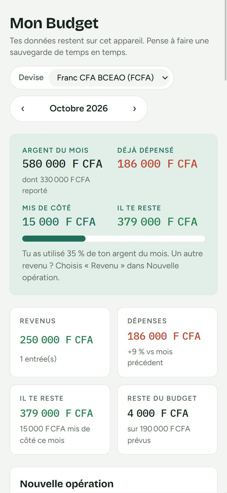

# Mon Budget

Application web gratuite pour gérer son budget : argent du mois, dépenses, dépenses fixes, budgets par catégorie, épargne, bilan et conseils.

**Essayer l'appli : https://alimathiam.github.io/Mon-budget/**



- Fonctionne sur téléphone et ordinateur, et s'installe comme une appli.
- Marche sans connexion une fois ouverte une première fois.
- Le mois peut commencer le jour de la paie, et ce qui reste peut être reporté sur le mois suivant.
- Montants en franc CFA par défaut (euro, dirham, dollar… au choix).
- **Compte gratuit (e-mail ou Google)** pour retrouver ses données sur tous ses appareils. Sans compte, les données restent sur l'appareil.

## Comptes et synchronisation

Avec un compte, les données sont gardées en ligne (Firebase) : on se connecte sur un autre téléphone et tout réapparaît. L'appli continue de marcher sans internet et envoie les changements dès que la connexion revient. Chaque personne ne voit que son propre budget.

Ce qui a été noté avant de créer le compte est ajouté au compte à la première connexion.

Pour activer les comptes, suis le guide [docs/FIREBASE.md](docs/FIREBASE.md) (environ 10 minutes, gratuit). Tant que `firebase-config.js` est vide, l'appli fonctionne sans compte.

## Sauvegardes sans compte

Sans compte, les données ne sont que sur l'appareil. Pour ne pas les perdre :

- Bouton **« Sauvegarder (JSON) »** dans « Catégories et réglages ».
  - **Sur téléphone**, il ouvre le menu de partage : choisis Google Drive, WhatsApp (à toi-même) ou ton e-mail pour garder le fichier hors du téléphone.
  - **Sur ordinateur**, le fichier va dans le dossier Téléchargements. Copie-le sur un Drive, une clé USB ou envoie-le-toi par e-mail.
- L'appli **rappelle de sauvegarder** tous les 30 jours (bouton « Plus tard » pour reporter d'une semaine).
- Pour récupérer tes données (nouveau téléphone, navigateur vidé) : « Importer une sauvegarde » et choisis le fichier. L'import remplace les données présentes.

## Fichiers

- `index.html` : la page.
- `style.css` : l'apparence.
- `app.js` : l'affichage et les actions.
- `sync.js` : comptes et synchronisation (Firebase), actifs seulement si `firebase-config.js` est rempli.
- `firebase-config.js` : identifiants du projet Firebase ; `firestore.rules` : règles de sécurité de la base.
- `calc.js` : les calculs (périodes, totaux, report, rappel de sauvegarde), sans lien avec la page, pour pouvoir les tester.
- `tests/` : tests des calculs.
- `manifest.json` : nom, couleurs et icônes pour l'installation sur téléphone.
- `sw.js` : service worker qui permet l'utilisation hors ligne.
- `icons/` : icônes de l'application.

## Lancer en local et tester

```bash
python -m http.server 8000
```

Puis ouvrir http://localhost:8000.

Tests des calculs (Node.js 18 ou plus, rien à installer) :

```bash
npm test
```

## Mettre en ligne gratuitement avec GitHub Pages

1. Crée un dépôt public sur GitHub (par exemple `mon-budget`).
2. Mets-y tous les fichiers de ce dossier.
3. Dans le dépôt : **Settings → Pages → Source : Deploy from a branch → Branch : main / (root)**, puis enregistre.
4. Après une minute, l'appli est disponible à `https://<ton-pseudo>.github.io/mon-budget/`.

## Installer sur un téléphone

- **Android (Chrome)** : ouvrir le lien, puis menu ⋮ → « Installer l'application » ou « Ajouter à l'écran d'accueil ».
- **iPhone (Safari)** : ouvrir le lien, bouton Partager → « Sur l'écran d'accueil ».

## Après une mise à jour

Changer `VERSION` dans `sw.js` (par exemple `mon-budget-v5`) pour que les téléphones récupèrent la nouvelle version.
